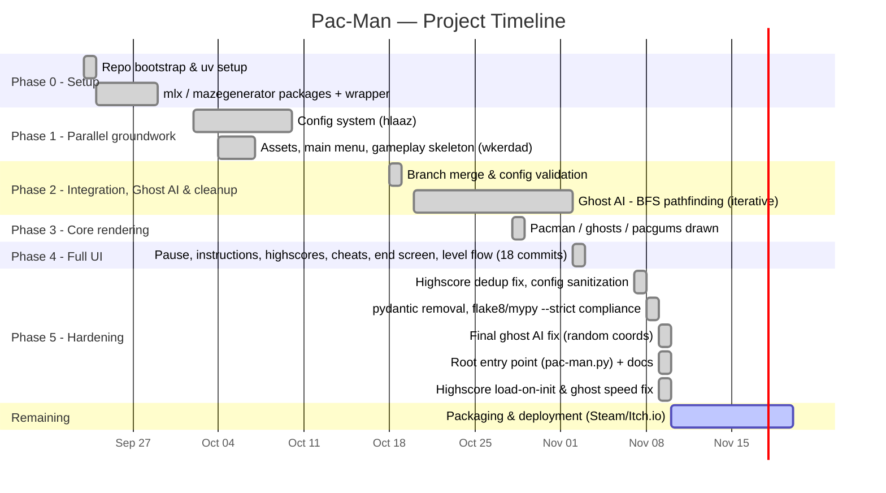

# Timeline (Gantt)

The project ran from **2026-09-23** to **2026-11-09** (about seven
weeks), in six phases (0–5), plus a final phase still remaining
(packaging & deployment). Dates are taken directly from `git log`;
GitHub renders the chart below natively.

See [`kanban.md`](kanban.md) for the current snapshot of what's done,
in progress and still to do.

## Phases at a glance

| Phase | Dates | Focus |
|-------|-------|-------|
| 0. Setup | 2026-09-23 – 2026-09-28 | Repository bootstrap, dependency management, external packages |
| 1. Parallel groundwork | 2026-10-02 – 2026-10-09 | Config system on one branch; assets/menu/gameplay skeleton on another |
| 2. Integration, Ghost AI & cleanup | 2026-10-18 – 2026-11-01 | Branch merge, full config validation, ghost AI with BFS pathfinding, a directory reorganization along the way |
| 3. Core rendering | 2026-10-28 | Pac-Man, ghosts and pacgums drawn and rendered on screen |
| 4. Full UI | 2026-11-02 | Pause/instructions/highscores/end screens, cheat mode, level flow — **18 commits in one day**, the most productive day of the project |
| 5. Hardening | 2026-11-07 – 2026-11-09 | Highscore & config fixes, pydantic → dataclasses, lint/mypy --strict compliance, root entry point, two more small direct-to-`main` fixes |
| 6. Remaining | — | Packaging & deployment to a public platform |

Four GitHub pull requests mark the points where feature branches were
formally merged back into `main`: **PR #3** `feat/ghost-ai` (merged
2026-10-30), **PR #4** `fix/ghost-ai` (merged 2026-11-02), **PR #5**
`work_with_the_conf` — the big UI/config merge (merged 2026-11-02), and
**PR #6** `fix/highscores` (merged 2026-11-09). Two later commits
(`fix loading the highscore in screen`, `fix speed of ghosts`, both
2026-11-09) were pushed directly to `main` without a PR.
